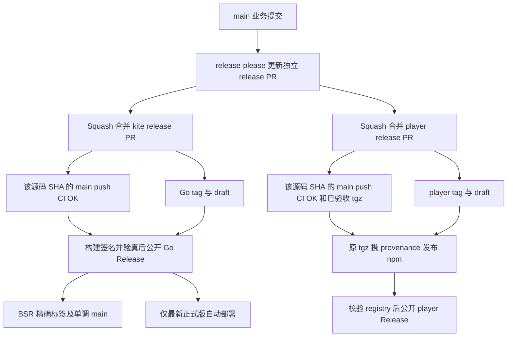

# 贡献指南

感谢你有兴趣为 kite 贡献!本文档是**分支、commit、PR 规范的权威来源**(人和 agent 共用)。架构边界与代码约束见 [`AGENTS.md`](AGENTS.md),二者不重复。

## 开发环境

- **Go 版本以 `go.mod` 为准**,Node 大版本以 `Makefile` 的 `NODE_VERSION` 为准。不必为了本地检查安装宿主机 Go / Node,已有 Docker 时可用下方隔离入口。
- **buf**:改 `proto/` 时需要(Makefile 自动探测 `$GOPATH/bin/buf`)。安装见 [buf.build](https://buf.build/docs/installation/)。
- **脚本检查**需要 Python 3、PyYAML、jq 和 ShellCheck;PyYAML 版本由 `make ci-env` 给出。Docker 环境已包含这些工具,不修改宿主机 Python。

## 常用命令

```bash
make proto       # 改 proto 后重新生成 gen/(gen/ 已进版本控制,改完记得 git add)
make docs        # 改命令树后刷新 docs/cmd/(freshness 守护测试依赖此 target)
go build ./cmd/server/    # 编译服务
go build ./cmd/kite/      # 编译 CLI
go test ./...             # 测试
go vet ./...              # 检查
```

### Docker 开发工具链

```bash
make docker-run                            # 进入隔离的 Go / Node 开发环境
make docker-run CMD='go test ./...'         # 在同一工具链中执行指定命令
make docker-check                          # Linux make check + player 源码与真实 tarball 验收
```

首次构建需要联网下载工具链和依赖;之后复用镜像层及每个工作区独立的 Go、npm、Chromium 缓存。源码仍是当前工作区,生成物按宿主机 UID/GID 写回;Linux `node_modules` 不复用 macOS 原生依赖。可以传入 `GOPROXY`,不挂载宿主机 HOME、Docker socket 或发布凭据。

升级 `go.mod` 工具链或 Node 大版本时,同步 `Dockerfile.dev` 对应镜像摘要并运行 `make docker-check`;入口会拒绝实际编译器版本与声明不一致的镜像。

这是开发检查环境,不是生产镜像;`Dockerfile` 和 `Dockerfile.release` 保持原用途。容器不替代 macOS / Windows runner、Rust 互操作、漏洞数据库扫描或正式签名发布;需要 Docker daemon 的镜像冒烟在宿主机或 CI 执行。

## CI 约定

- **本地自检**:`make check`(gofmt + go mod tidy + ShellCheck/脚本回归 + vet + test + lint + proto-lint)。部署事务和安装器回归需要 Linux,macOS 会明确打印 skip;`make docker-check` 会在 Linux 执行它们。`make vuln`、`make proto-breaking`、`make verify-gen` 依赖网络或 git 基线,按需单独跑。
- **先计划,再执行**:`scripts/ci-plan.py` 是任务注册表和选取规则的唯一来源。PR 按完整 base…head 差异选择检查,保留重命名前后的影响;main push 执行全部确定性检查。公开播放器协议变更同时覆盖 Go 和 player,可执行示例变更覆盖相应消费者,控制面变更和未知路径保守扩大检查。
- **门禁只有一个**:`CI OK`。门禁重算计划并验证 SHA、run/attempt 和事件上下文,同时核对实际 workflow jobs 与 `needs`。只有计划明确授权的不适用任务可以跳过;失败、取消、缺失任务、必需任务跳过或未注册 job 都不能变绿。PR 标题编辑也不能绕过源码检查。
- **工具版本的唯一来源**:Go 以 `go.mod` 为准;Node / golangci-lint / buf / govulncheck / cargo-audit / GoReleaser / Cosign / PyYAML 以 `Makefile` 顶部为准,Rust 以 `interop/rust/rust-toolchain.toml` 为准。第三方 Actions 固定完整 commit SHA,镜像 base 固定 digest;不要在 workflow 重复维护工具版本。
- **漏洞门禁**:依赖或安全控制面变化时扫描对应模块,`scheduled.yml` 每日扫描根 Go 模块、`interop/go`、player 的完整 npm 依赖树及 Rust。已知修复版本必须失败,不能因为它高于当前工具链就当成「尚未发布」;无修复版本保留 advisory 并更新 issue。安装、执行和解析故障显式失败,某个扫描器失败不阻断其它已选扫描。
- **执行隔离与排队**:PR 只使用托管 runner;Go 测试覆盖 Linux / macOS,另做 Windows vet。PR 的旧 CI 可以取消;main 按 SHA 保留发布证据。发版、BSR、部署各自使用 [`queue: max`](https://docs.github.com/en/actions/how-tos/write-workflows/choose-when-workflows-run/control-workflow-concurrency),不替换队列内等待项;GitHub 上限为 100 个 pending,满队列后的新运行会取消。
- **release PR 的 CI**:`GITHUB_TOKEN` 创建 PR 不保证触发后续 workflow。`scripts/release-pr-ci.sh` 仅处理本仓 `github-actions[bot]` 创建、目标 main 的 `kite` / `player` 固定 release 分支;批准或补派发前再次核验准确 HEAD。已有成功 producer 不重复派发,同名 fork 和其它 bot 不获授权。
- **Go 产物与镜像**:`Go Artifacts and Images` 将跨平台编译集中到一次 GoReleaser snapshot,再验证开发镜像及由 snapshot 二进制构建的发布镜像。冒烟检查无令牌拒绝启动、健康检查和 REST 鉴权,不以 Dockerfile 文本断言代替运行时验证。正式公开前仍须验证发布镜像双架构。
- **Go / Rust 消费者**:`Contract Go Consumer` 跑 `make interop-go`,通过锁定的 BSR SDK 验证真实 server;`Contract Rust Consumer` 跑 `make interop-rust`,由当前 proto 生成 tonic 客户端后验证健康、鉴权和错误契约。文档示例与对应 `interop/` 源码逐字一致,改示例先改文档再同步。
- **player 源码与成品**:`Player Source and Package` 先完成类型检查、Biome、测试和构建,只 pack 一次,再在仓库外安装同一 tgz,验证严格 TypeScript、ESM、React SSR、独立打包和 Chromium 交互。成功的 main CI 上传 tgz 与含 SHA / run / attempt / 摘要的 manifest,保留 30 天。`make player-check` 检查源码;`make player-package-check` 还验收可发布成品,不依赖真实网易云接口。
- **真实上游冒烟**:`make upstream-smoke` 对真实上游逐个调用只读 RPC,专抓「成功但返回空」。它依赖外部服务,手动运行、不进确定性门禁。endpoint 响应夹具优先来自裁剪并去隐私的真实响应。
- **仓库配置不是 YAML**:`python3 scripts/github-settings.py` 默认只读审计;管理员确认后用 `--apply` 配置 main / 两类发布 tag ruleset、Actions 策略及 `production` / `npm` 的 main 分支白名单。脚本不读取、迁移或删除 secret 值,也不移除已有人工审批;与自动部署冲突的规则须由管理员先处理。AI Review 已移除,不作为 CI 或发布依赖。

## 发布与恢复

Go 产品(CLI + server)仍共用版本;player 是独立发布单元。版本和 CHANGELOG 由 release-please 从各自路径的 Conventional Commits 生成,**不再手改 player 版本号来发版**。根 CHANGELOG 只记 Go 产品,player 的记录位于包内;既有混合历史不改写。tag 分别为 `vX.Y.Z` 和 `player-vX.Y.Z`,GoReleaser 显式选择 Go current / previous tag,不会把 player tag 当作 Go 版本。

纯 Go 变更不会触发 player 发版,纯 player 变更不会触发 Go 发版;共享协议变更可以产生两张 release PR,分别批准。普通业务 PR 合并只更新候选版本,不是发布批准。



### Go 发布

合并 kite release PR 后,release-please 建 tag / draft,同一编排调用 `release.yml`。所有跨平台档案、签名校验和、双架构镜像、签名部署安装包完成并验真后才公开。仅最大正式版推进 `latest`,minor 标签也只前进;已公开的产物不可重建或覆盖。失败 draft 可以在 main 上派发 `release.yml` 并指定原 Go tag 恢复;公开版缺损必须发修正版。

只有已公开且验真的 Go 正式版进入 BSR 和生产部署。BSR 精确标签保留,`main` 只前进;自动部署旧版不切换线上,管理员在 main 上显式派发 `deploy.yml` 才允许回滚。缺 token / secret、部署器过旧或探针失败都明确变红。部署步骤见 [`docs/deploy.md`](docs/deploy.md)。

### npm 发布

`npm.yml` 校验本仓受信 player release PR、tag 指向及指定源码 SHA 的成功 main push CI,只下载该 run / attempt 的 `kite-player-package-*`。核对 manifest、包名、版本、SHA-256 / SHA-512 与 tgz 后,**发布已经验收的字节,不在发布端 build / pack**。需要 `npm` environment 中可发布 `@violetjs` scope 的 `NPM_TOKEN`;不要配置在仓库 / 组织级,迁移验证后由管理员移除同名旧项,避免环境缺项时回退。

调用 `npm.yml` 的 job 必须逐项传递 `NPM_TOKEN`,callee 通过 `workflow_call.secrets` 声明 `required: true`;值只在真正 publish 的步骤注入。即使 token 只存在于 environment,也不能省略调用方绑定:[GitHub 明确说明省略会得到空字符串](https://docs.github.com/en/actions/how-tos/reuse-automations/reuse-workflows#using-inputs-and-secrets-in-a-reusable-workflow)。`required` 校验绑定是否存在,发布脚本仍负责拒绝空值。

首次发布还要求当前 workflow 的源码 SHA 等于包的源码 SHA,保证 provenance 真实。正式版用 `latest`,预发布用 `next`;registry 校验成功后才公开 player Release,并始终设置 `make_latest: false`,不替换 GitHub 的 Go Latest,也不触发 BSR / server 部署。

相同版本已经存在时,必须校验 registry 的 integrity 和实际字节;一致只恢复 GitHub 发布收尾,不再 publish,不一致立即失败。不存在的版本、网络故障和鉴权失败不能混为一谈。

从仓库级 `NPM_TOKEN` 迁移时,按以下顺序操作,不要先删除旧凭据:

1. 管理员先运行 `python3 scripts/github-settings.py --apply`,创建 `npm` environment 及 main 白名单。`gh secret set --env npm` 不会自动创建环境;环境不存在时,获取密钥公钥会返回 404。脚本应用保护配置后若只报告 secret 缺项,表示仍需完成下面的凭据步骤,不代表前面的配置已回滚。
2. 在本机终端交互录入有效 token:`gh secret set NPM_TOKEN --repo VOD-Studio/kite --env npm`。GitHub 不提供旧 secret 的原值,需要使用自己保管的值或重新创建 token;不要将值写进命令参数、仓库文件或聊天。
3. 保留仓库级旧 token,直到 `main` 上的 `npm.yml` 已切换到 `environment: npm`,且 `Release Please` 的调用 job 已显式绑定 `NPM_TOKEN`;切换前旧工作流仍依赖仓库级凭据。
4. 确认环境中的 token 已设置、工作流已切换后,运行 `gh secret delete NPM_TOKEN --repo VOD-Studio/kite` 删除仓库级旧项,再运行 `python3 scripts/github-settings.py` 完成只读审计。不要用一次正式发布来试验凭据迁移。

### 恢复规则

- **发布队列来源**:release-please 读取实时 main,较早运行可能代后续提交建立 draft。每个运行仍只接管自己的 `GITHUB_SHA`,不依赖 action 当次是否返回“创建成功”。普通业务提交不能接管其它源码的发布。
- **player 首次发布因临时故障或凭据缺项失败**:原工作流代码正确时,完整重跑原 release PR 合并 SHA 对应的 `Release Please` 运行,不要只重跑失败 jobs;其发布分支之前可能被跳过。不要在较新的 main 上手动派发来冒充旧源码的 provenance。
- **原工作流代码有缺陷**:重跑沿用原 `GITHUB_SHA`;仓库内 `./.github/workflows/...` 的 callee 也来自调用方同一提交,不会自动采用新 main 的修复。若原 SHA 无法完成首次发布,必须通过包含修复的新 release PR / 版本重新交付,保留旧 tag,不移动 tag、不替换已验收 tgz。不要把“修复合并后重跑原运行”当成通用恢复方案。
- **CI 产物过期 / 缺失**:在原运行仍可重跑时,重跑原源码的 main push CI,产生新的成功 attempt 和已验证产物,再重跑原发布编排。发布端没有“重新 pack 凑一个包”的兜底。
- **npm 已存在且字节一致**:可在 main 手动派发 `npm.yml`,指定 player tag,仅完成一致性校验及 GitHub Release 收尾。
- **恢复时限**:GitHub [仅允许在首次运行后 30 天内重跑,每个运行最多重跑 50 次](https://docs.github.com/en/actions/how-tos/manage-workflow-runs/re-run-workflows-and-jobs)。产物缺失且原运行已不可重跑,或无法恢复原 SHA 的首次发布上下文时,须通过新的 release PR / 版本重新交付;不能移动旧 tag、伪造 provenance 或覆盖已发布字节。npm 已存在的版本也必须取得原 CI 成品才能比较,不能只凭 registry 存在就补标发布成功。
- **Go 已公开**:可重跑 `release.yml` 验证原产物并恢复适用浮动标签;BSR 或部署失败分别在 main 派发 `bsr.yml` / `deploy.yml`,指定已公开 Go tag。不重发、不覆盖公开产物。

## 工作流(分支与提交)

### 分支命名

每个新任务 / 模块 / feature 先从 `main` 新建分支完成,不在 `main` 上直接开发。

**分支单位是 feature / PRD,不是单个 issue**。一个 PRD 拆出的多个子 issue 属于同一工作单元,共用一个分支,在同一 PR 里推进(子 issue 在该分支上作为独立的原子 commit 落地,见下文「原子性」)。只有当 issue 之间**无依赖且分属不同 feature** 时才各自开分支。「一 issue 一分支一 PR」是过度拆分,与 commit 原子性反对的精神一致——会让 review 队列膨胀、强耦合 issue 难以协调合并顺序。

判据:若一组 issue 共享同一个 PRD 父节点,或互相有 blocked-by 依赖,它们就该在同一个分支。

格式:**`<type>/<scope>-<简述>`**

- **type** 对齐 Conventional Commits:`feat` / `fix` / `chore` / `docs` / `refactor` / `style` / `test` / `perf` / `build` / `ci` / `revert` / `hotfix`。PR 标题同样必须符合(CI 的 PR Title 检查):squash merge 后它就是 `main` 上的 commit message,release-please 靠它生成版本号与 CHANGELOG。
- **scope** 指向最内层模块(`netease` / `cli` / `server` / `proto` / `tui`)或文件 / 区域名(`readme` / `ci` / `deps`)。可省略(scope 难以定位单模块时)。
- 全小写,`/` 分段,`-` 连词。无空格、无大写、无特殊字符。
- 简述用英文或拼音,短而清晰。

✅ 正确:
- `docs/readme-rewrite`
- `feat/cli-lyric-flag`
- `fix/netease-fee-field`
- `chore/deps-bump-bubbletea`
- `refactor/server-shutdown`

❌ 错误:
- `feature/这是一个很长的中文分支名`(冗长 + 中文)
- `update`(无 type 无 scope)
- `Fix/Login`(大写)
- `new-feature`(无 scope,scope 难定位时可省,但能定位就该写)

### Commit message 格式

- 中文 Conventional Commits:`feat(cli): 添加新功能` / `fix(netease): 修复接口 bug` / `refactor(server): ...`。
- **scope 指向最内层模块**,不叠加冗余前缀。
  - ✅ `fix(netease): artist albums fee 字段补全`
  - ✅ `feat(cli): song play 支持歌词同步`
  - ❌ `fix(api/netease): ...`(`api` 是冗余前缀,kite 是单体仓库)
  - ❌ `feat(kite): ...`(改动集中在一个子模块时,scope 用模块名而非项目名)
- **body 用 bullet points 列改动事实**,不写散文,不夹带主观评判与设计论证。决策过程写 PR 描述或 ADR。
- **本地 commit,不推送**。PR 由人工 review 后合并。

### 原子性

> 业界共识([fnune](https://fnune.com/2018/02/19/git-best-practices-atomic-commits/)、[Fagner Brack](https://fagnerbrack.com/one-commit-one-change-3d10b10cebbf)):**一个 commit = 一个逻辑变更**。

核心判据(只这三问,不列优先级表):

1. **单独 revert 会让构建坏掉吗?** 会 → 拆得不够,或拆错了粒度。
2. **三个月后看标题能一眼知道做了什么吗?** 不能 → 标题太笼统,或一个 commit 混了多件事。
3. **它服务的是同一个任务吗?** 一个任务可跨多文件、多层;混多个无关任务才该拆。

**反对过度拆分**。原子性服务于可读性与可回滚,不是为了「切碎」。例:「给 `song play` 加 `--lyric` 同步歌词」是一个完整任务,可以一个 commit 含 flag 解析 + 歌词获取 + 播放器集成。强行拆成「加 flag」「加歌词获取」「接入播放器」三个 commit,每个单独看都不完整,反而破坏可读性。

**draft 阶段宽松**。开发中可以先随便提交(WIP、调试片段都行),最后用 `git rebase -i` 整理成原子 commit。不要求边写边原子——要求的是**最终进入 main / PR 的历史是原子的**。

### PR 与 issue 规范

**Issue 标题**:

- 格式 **`[scope] 描述`**,scope 用最内层模块名(同 commit scope 规则)。
- ✅ `[netease] artist albums 接口 fee 字段补全`
- ✅ `[cli] song download 断点续传失效`
- ❌ `vertical: 补全挂载`(暴露实现方法论,不该出现在标题)
- 连续任务序列(如某 feature 的 T1–Tn)带 `Tn` 编号;独立 feature 不带编号。

**Issue labels**:

- **默认不加 label**。仅当改动性质明确匹配 GitHub 内置语义 label 时才加(如 `bug`、`documentation`)。
- 不加 `ready-for-agent` 等流程性 label——对人工 review 无信息量。

**PR 创建**(`gh pr create`):

- **assignees**:`--assignee @me`(当前 gh 账号)。
- **reviewers**:仓库全部 collaborator——`--reviewer DefectingCat,xunrua,JingpengZhang`。
- **labels**:默认不加(同 issue 规则)。
- **base**:指向 `main`(仓库默认分支)。

**合并**:

- **手动合并**,不启用 auto-merge。审批是协作约定,不是强制要求作者无法给自己完成的审批数量。
- **业务 PR 自选 Merge / Squash / Rebase**:需要保留原子提交时选 Merge 或 Rebase;Squash 只在 main 留一个汇总提交。PR 标题和所有非 merge 原子提交都必须符合上面的 Conventional Commits,确保任意合并方式都能正确推导版本。
- **release PR 使用 Squash**:这是版本 / changelog 的发布批准记录,不是业务提交归档。普通 PR 合 main 只累计待发布变化;合并 `chore(main): release ...` PR 才启动正式发版与自动部署,不混淆这两类合并。
- **分支清理按需执行**:合并后确认无未交付修改再删除;Squash / Rebase 后不要仅凭 `git branch --merged` 判断是否已合入。仓库治理脚本不擅自改变自动删分支偏好。

## 报告安全问题

见 [`SECURITY.md`](SECURITY.md)——**不要在公开 issue 报安全漏洞**,走 GitHub 私有安全公告。

## 项目结构

详见 [`AGENTS.md`](AGENTS.md)「架构与代码边界」。依赖方向由 `internal/archtest` 测试守护;`gen/`、`docs/cmd/` 是生成产物,已进版本控制(不要手改)。
