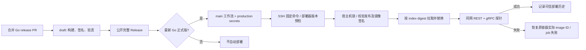

# 生产部署

kite-server 的容器只加入 kite 专用网络 `kite_network`(网络别名 `kite`,首次部署时创建),不映射宿主机端口。
同机的调用方把自己的后端容器加入 `kite_network`,经 `http://kite:3721`(REST)/ `kite:3722`(gRPC)访问;
加入这个网络只能看到 kite(和其它调用方加入的容器),看不到各项目自己网络里的数据库等容器。
监听非回环地址,所以访问令牌是必需的(见 [server-security.md](server-security.md))。

## 日常发布与权限边界

业务 PR 可以 Merge / Squash / Rebase;合 main 只累计待发布变化。**Squash 合并 Go 产品的 release PR 才批准 Go 发版**;player 独立发布,不进入此部署链路。
发布流水线先完成并验证二进制档案、签名校验和、镜像和部署安装包,再公开 release。只有数值最大的 Go 正式版自动部署,补旧版本不会把线上倒退。
正常发版不增加 production 人工审批,也不需要手动登录服务器;显式回滚仍由管理员在 main 手动派发部署。



- **单机单实例**:接受替换容器时的短暂中断,不使用蓝绿或滚动集群。
- **CI 只有应用部署权**:托管 `ubuntu-24.04` runner 使用专用 SSH 密钥,不能获得交互 shell、端口转发或上传特权脚本。服务器的 forced command 仅接受 `version` 和固定仓库的精确 `vX.Y.Z` 引用;sudo 只允许 root 管理的部署程序。
- **主机维护归管理员**:系统依赖、部署器和 SSH 授权只能由管理员安装。普通应用 release 不会升级 root 程序;安装器源码在仓库中更新不等于线上已更新。
- **来源与内容都要验证**:首次部署某版本先核验公开正式 release / tag commit,再验证固定仓库 main 发布工作流的 Cosign keyless 签名。验的是 OCI **index digest**,随后从该 index 选取唯一的本机 Linux 平台 manifest,以其 digest 拉取并启动,核对镜像版本 / commit 标签;历史分别记录 index 与平台 digest。
- **操作不可并发**:Actions 使用 `queue: max` 排队,服务器还用 `flock` 串行化安装和部署,不依赖单一 workflow 的互斥。
- **故障明确失败**:缺 secrets、部署器过旧、验签失败、探针失败都使 job 变红。发布、BSR 和部署是不同状态;已公开 release 不会因为部署失败被删除或重写。

`kite-probe` 以非 root、只读文件系统、无额外 capabilities 的独立容器运行,加入 `kite_network`,
使用宿主机已安装的静态探针及同一 Podman secret。它检查 REST/gRPC 健康、无服务令牌拒绝访问、
有服务令牌但无网易云 cookie 返回 `LOGIN_REQUIRED`,**不访问网易云**。因此老版本镜像不含探针也能验证。
探针成功输出检查结果;最终失败输出最后一次诊断,随后执行回滚,不再把协议错误全部丢弃。
本部署链路当前以明文探测(部署器不设置 `KITE_SERVER_TLS_*`);自建部署启用了服务端 TLS 时,
探针须按 [`docs/server-security.md`](server-security.md) TLS 章节设置 `KITE_PROBE_CACERT`(私有 CA)
或 `KITE_PROBE_TLS=true`(公共 CA),否则明文探测必然失败。

## 管理员首次切换

这一步是从旧部署方案迁移到新信任边界,不是每次发版的操作。没有把管理员 SSH 私钥交给 CI 来消除它。

1. 合并本次工作流改造。管理员在 GitHub 创建 / 配置 `production` environment,使用下表新的
   `KITE_PRODUCTION_*` 名称重新设置 secrets。它们不得配置在仓库 / 组织级;新流程不引用旧 `KITE_DEPLOY_*`,
   因此环境漏配时不会静默使用迁移期间尚未删除的旧凭据。
2. 从可信 main 工作树运行 `python3 scripts/github-settings.py --apply`,再运行不带参数的只读审计。
   脚本保留业务 PR 的三种合并方式,要求 main 走 PR + `CI OK`,保护 Go / player 两类 release tags 不被改写 / 删除,
   限制 production 和 npm environments 只接受 main,要求第三方 Action 固定 SHA,保持默认只读 token。
   如果已有环境审批 / 等待规则,脚本会在任何写入前拒绝整次 `--apply`,不会重写或删除它们;
   管理员需先审核并处理与「release PR 是唯一日常批准点」的冲突。
3. Squash 合并下一个 Go release PR。首个新版 release 的构建 / 验真 / 公开仍可完成;
   **如果服务器尚未安装新部署器,自动 Deploy 将明确失败,旧实例不动**。
4. 按下一节验证这个新 release 的签名安装包,由管理员安装。不能从旧 release 下载不存在的新版安装包,
   也不能直接复制仓库里的一个脚本冒充完整安装。
5. 从 **main** 重跑该版本的 Deploy,确认实际探针及部署历史成功。之后合并 Go release PR 后,最新正式版自动部署。
6. 新链路验证成功后,管理员删除旧仓库级 `KITE_DEPLOY_*` secrets,再次执行只读审计。
   `github-settings.py` 无法读取 secret 值,不会自动迁移或删除它们;旧项或新的同名仓库 / 组织项都会明确报告。

### GitHub secrets

| 位置 / secret | 用途 |
|---|---|
| `production` / `KITE_PRODUCTION_SSH_KEY` | 专用部署私钥;不是管理员私钥 |
| `production` / `KITE_PRODUCTION_KNOWN_HOSTS` | 经可信渠道核对过指纹的 SSH known_hosts 内容 |
| `production` / `KITE_PRODUCTION_HOST` | 部署服务器地址 |
| `production` / `KITE_PRODUCTION_PORT` | 可选,默认 SSH 22 |
| 仓库 / `BUF_TOKEN` | BSR 发布专用;只传给 BSR,不传给 Deploy |

通过 GitHub environment 设置页或 `gh secret set --env production` 配置。
先从服务器控制台等可信渠道核对主机公钥指纹,**不能只运行 `ssh-keyscan` 就认为完成了身份验证**。
不再需要 `RUNNER_STATUS_TOKEN`,也不把部署密钥放在 PR / 仓库通用作用域。

GitHub 的 environment 选择**不排除**仓库 / 组织同名 secret,只是优先取环境值,因此新名称必须只放在 production,
并由治理审计检查错误作用域。复用工作流调用处仍须逐项传递这些名称;Deploy 在声明 `environment: production`
的 job 中取得环境值,不使用 `secrets: inherit` 把其它凭据一并传入。

## 版本化部署器安装

服务器要求 Linux amd64 / arm64、systemd、rootful Podman(启用 DNS 的 `kite_network`),
以及 Skopeo、Cosign、curl、jq、GNU coreutils / flock、OpenSSH 工具、sudo / visudo、OpenSSL。
Cosign 使用项目 `Makefile` 固定的工具版本。依赖安装 / 系统升级归管理员,安装器不隐式安装软件。
`podman-restart.service` 必须能够启用,否则安装失败,不能声称已有重启恢复能力。

先在安全的管理员工作站生成独立的部署密钥:

```bash
ssh-keygen -t ed25519 -N '' -C kite-deploy -f kite-deploy
```

将公钥交给服务器管理员,私钥只配置到 `production`。管理员从目标公开 release 下载包和 Sigstore bundle,
**验签成功以后才解包 / 执行**。以下命令在已有 `gh`、Cosign 的管理员环境执行;`TAG` 取实际已公开的新版本:

```bash
TAG="$(gh release view --repo VOD-Studio/kite --json tagName --jq .tagName)"
work="$(mktemp -d)"
gh release download "$TAG" --repo VOD-Studio/kite --dir "$work" \
  --pattern "kite-deployer_${TAG}.tar.gz" \
  --pattern "kite-deployer_${TAG}.tar.gz.sigstore.json"
cosign verify-blob \
  --bundle "$work/kite-deployer_${TAG}.tar.gz.sigstore.json" \
  --certificate-identity-regexp '^https://github\.com/VOD-Studio/kite/\.github/workflows/(release|release-please)\.yml@refs/heads/main$' \
  --certificate-oidc-issuer https://token.actions.githubusercontent.com \
  "$work/kite-deployer_${TAG}.tar.gz"
tar -xzf "$work/kite-deployer_${TAG}.tar.gz" -C "$work"
```

包内包含三个部署脚本、`deploy-version` 和两种 Linux 架构的静态 `kite-probe`。
将已验证的完整解包目录及公钥传到服务器,在该目录执行:

```bash
sudo ./deploy-server-install.sh /absolute/path/to/kite-deploy.pub
```

安装器创建 / 检查专用账户、root 持有的 SSH 授权和 sudoers,建立私有状态目录,
并在不存在 `kite-auth-token` Podman secret 时生成访问令牌。
令牌备份在 `/srv/kite/auth-token`(root 0600),重复安装不轮换;已有备份却丢失 secret 时必须由管理员显式恢复。

| 服务器路径 | 含义 |
|---|---|
| `/usr/local/libexec/kite/versions/<能力版本>-<内容摘要>/` | 不覆盖的安装构建,由六个包成员的规范名称和内容计算摘要 |
| `/usr/local/libexec/kite/current` | 管理员安装时原子切换的当前构建 |
| `/usr/local/libexec/kite/deploy-ssh-gate.sh` / `deploy-server.sh` | 固定入口,指向当前 root 管理的构建 |
| `/srv/kite/` | root 0700 状态目录,包含互斥锁、令牌备份及可信历史 |
| `/srv/kite/deploy-history.json` | root 0600;成功部署的时间、版本、commit、index / 平台 digest、部署器版本与构建摘要 |

`scripts/deploy-version` 表示能力兼容性,应用工作流将其作为宿主机最低版本。
同一能力版本的新编译内容可以由管理员显式安装到新的内容寻址目录,旧目录不被覆盖;
不能仅因为应用发版重新编译了探针,就强迫每次更新服务器部署器。
需要新能力时提升该版本,管理员完成升级后再重跑失败的 Deploy。

旧文本 `/srv/kite/deploy-history` 缺少 commit 和完整验签证据,**不会自动提升为可信 JSON 历史**。
旧镜像首次被新部署器选择时仍需完成发布 / 签名验证。

## 手动补部署 / 回滚

在 Actions → Deploy → Run workflow 中选择 **main** 并填写已公开 tag,或:

```bash
gh workflow run deploy.yml --ref main -f tag=v0.4.0
```

- **自动失败回滚**:切换前保存旧容器实际本地 image ID,候选启动 / 探针失败或收到终止信号时恢复它,
  不重新解析旧 tag。失败不会记成功历史;回滚本身失败会输出 `CRITICAL`,需要管理员介入。
- **人工选择已部署版本**:使用 root 可信历史中的 index digest,不重新信任可能移动的 registry tag。
  仍需 registry 中保留该 digest;不要清理仍在回滚保留范围内的镜像。
- **人工选择从未由新部署器部署的旧版本**:重新验证公开 release、签名和 metadata 后才切换。
- **重跑 Release**:失败 draft 可继续完成;公开版本仅检查原产物并恢复适用浮动标签,不覆盖旧附件。
  原附件不完整 / 签名不成立时须发布修正版。需要补部署时优先运行 Deploy,不必重建应用。

## 调用方接入(同机项目,如 violet)

- 把后端容器加入 `kite_network`,并写进项目自己的部署配置——只手动 `podman network connect`,容器重建后就丢了。
  compose 示例(`external: true` 要求网络已存在,即 kite 至少部署过一次):

  ```yaml
  services:
    api:
      networks: [backend, kite]   # 保留项目原有的网络,追加 kite
  networks:
    kite:
      name: kite_network
      external: true
  ```

- 容器配了 `HTTP_PROXY` / `HTTPS_PROXY` 时,把 `kite` 加进 `NO_PROXY`:Go 的 HTTP 与 gRPC 客户端默认读这些变量,
  而 CIDR 形式的 `NO_PROXY`(如 `10.89.0.0/16`)只匹配 IP,不匹配主机名 `kite`。
- 地址 `http://kite:3721`;每个请求带 `Authorization: Bearer <令牌>`(令牌即 `/srv/kite/auth-token`,所有调用方共用)。
- 网易云登录态经请求头 `Grpc-Metadata-X-Netease-Cookie` 传入,由调用方保存;
  过期前调 `POST /api/v1/auth/refresh` 续期,收到 `LOGIN_REQUIRED` 时引导重新登录(见 [grpc-errors.md](grpc-errors.md))。
