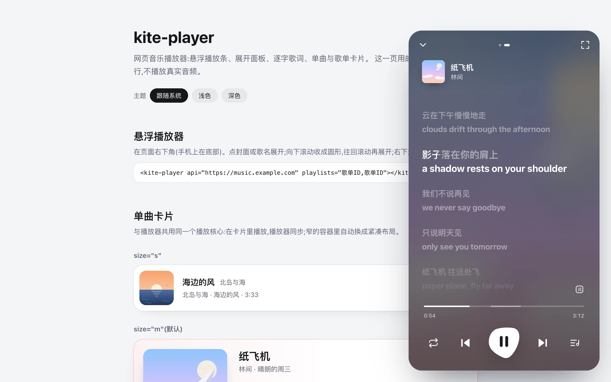
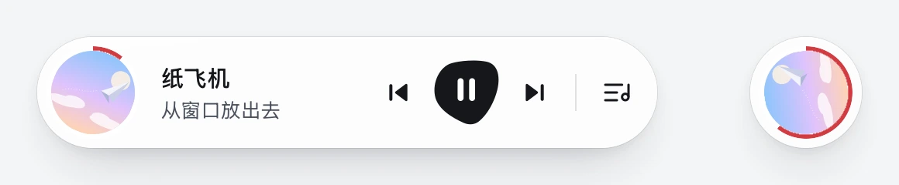
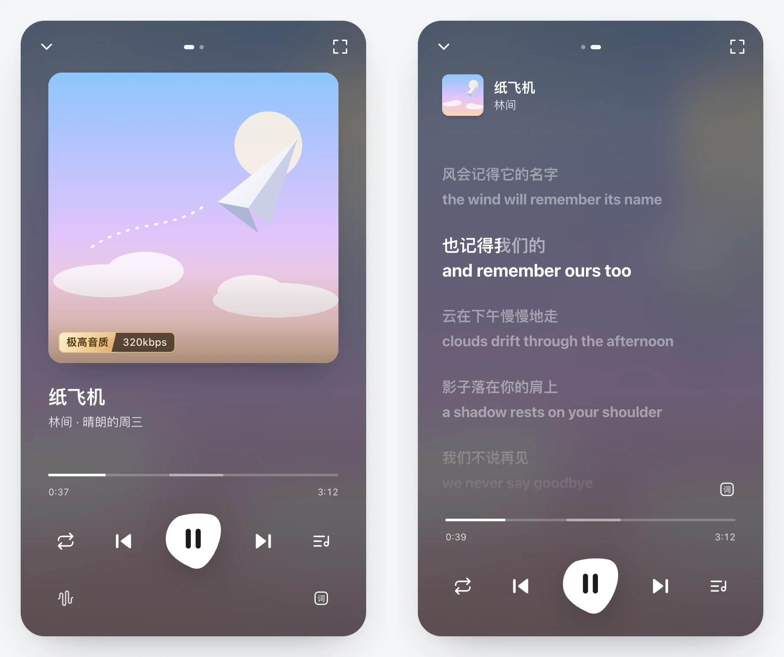
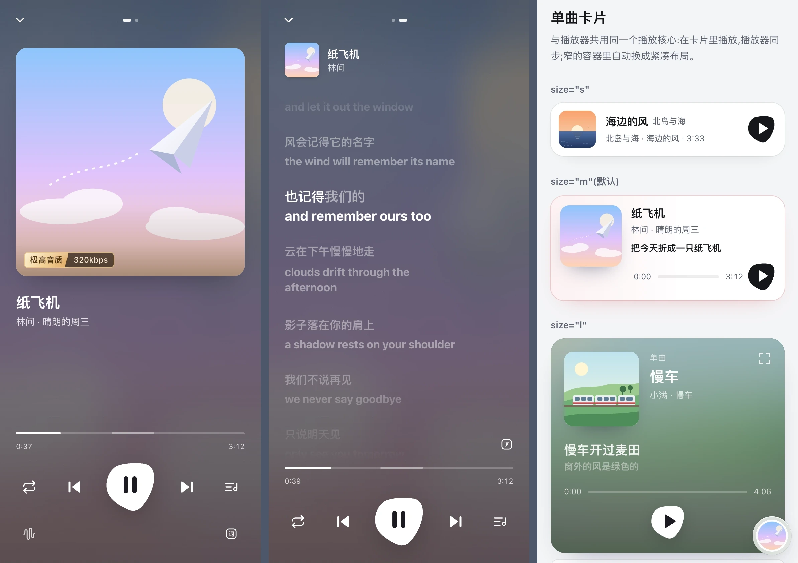
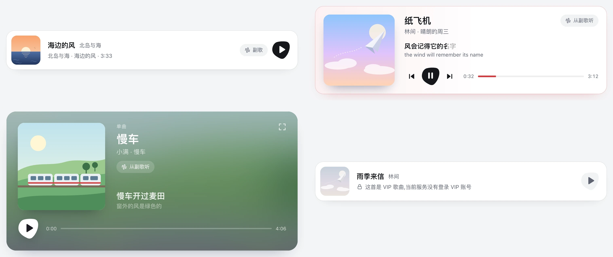
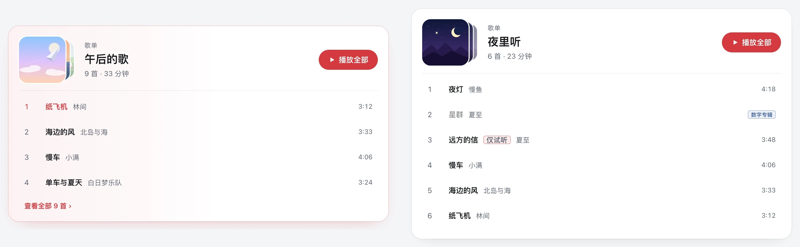
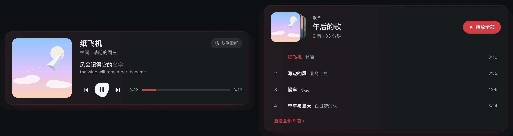
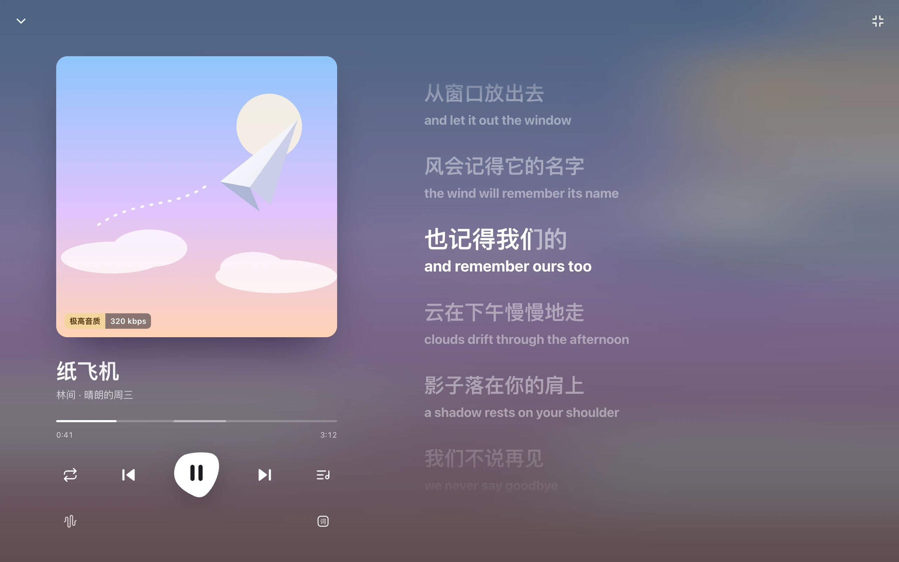
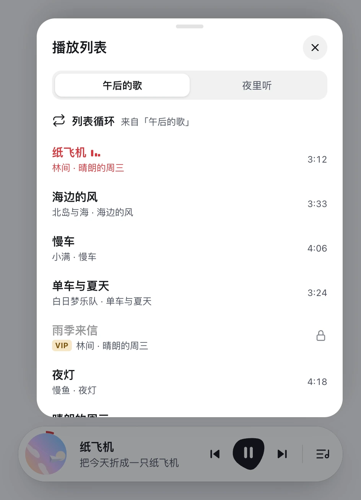

# @violetjs/kite-player

English · [简体中文](./README.zh-CN.md)

A web music player with a floating bar, track and playlist cards, and word-by-word lyrics. Use Web Components, React bindings, or the playback core on its own.

<p align="center">
  
</p>

- **One playback core per page.** The bar, panel, and cards share the queue and playback state.
- **Lyrics and controls.** Translations, lyric seeking, a chorus shortcut, four play modes, and system media controls.
- **Desktop and mobile layouts.** Collapse to a disc, expand to a panel or full screen, or enter immersive mode. Cards adapt to narrow containers.
- **Your backend.** Connect to your own [kite-server](https://github.com/VOD-Studio/kite), or implement a custom data source. Queue and position are remembered without autoplaying.

The player interface is currently in Simplified Chinese. Screenshots use fictional songs from the offline demo, not a live music service.

[Quick start](#quick-start) · [React](#react) · [Elements](#elements) · [Styling](#styling) · [Playback core](#playback-core) · [Gallery](#gallery)

## Quick start

### Before you start

You need a backend that serves the music data. For kite-server, [enable public mode](https://github.com/VOD-Studio/kite/blob/main/docs/player.md), allowlist your songs and playlists, and allow your website's origin. Use the public HTTPS origin as `api`, **not** the authenticated REST address or a URL ending in `/player/v1`.

Replace `https://music.example.com` and the IDs below with your deployment and allowlisted content. Keep server tokens and NetEase cookies on the server, never in the page. Playback availability depends on the upstream account and track rights.

### With a bundler

```sh
npm install @violetjs/kite-player
```

Import once in your client entry:

```js
import "@violetjs/kite-player/element";
```

Then add one player to your shared layout, and cards wherever you need them:

```html
<kite-player api="https://music.example.com" playlists="3778678"></kite-player>
<kite-track song="1973665667"></kite-track>
<kite-playlist playlist="3778678"></kite-playlist>
```

`api` on the player configures the shared core; cards use that same source. Plain HTML, Vue, Svelte, Astro, Dioxus, and Leptos can use these standard custom elements. Follow your framework's custom-element configuration where required.

### On a static page

No bundler is needed. The single-file build includes Lit, registers the elements, and exposes `KitePlayer`:

```html
<script src="https://cdn.jsdelivr.net/npm/@violetjs/kite-player@0.3.0/dist/kite-player.iife.js"></script>
<kite-player api="https://music.example.com" playlists="3778678"></kite-player>
<kite-track song="1973665667"></kite-track>
```

## React

Import from `@violetjs/kite-player/react`; a separate element-registration import is not required.

```tsx
import type { ReactNode } from "react";
import { KitePlayer, KiteTrack, usePlayerState, usePlaybackTime } from "@violetjs/kite-player/react";

export function Layout({ children }: { children: ReactNode }) {
  return (
    <>
      {children}
      <KitePlayer api="https://music.example.com" playlists="3778678" />
    </>
  );
}

export function NowPlaying() {
  const current = usePlayerState((state) => state.current);
  const time = usePlaybackTime(); // Frame updates stay in this component.
  return current ? <p>{current.title} · {Math.floor(time)}s</p> : <KiteTrack song="1973665667" size="s" />;
}
```

`KitePlayer`, `KiteTrack`, and `KitePlaylist` wrap the custom elements and forward refs to them. `usePlayer`, `usePlayerState`, and `usePlaybackTime` share the same core, so custom UI can coexist with the elements. The React entry supports server-side rendering and registers elements on the client. In React Server Component frameworks, use these exports within a client component.

## Elements

### Shared attributes

| Attribute | Values and behavior |
| --- | --- |
| `api` | Public backend origin, for example `https://music.example.com`. Set it on the player, or on a card when using cards without a player. |
| `theme` | `auto` (default, follows the system), `light`, or `dark`. |

### `<kite-player>`

Use one per page. It loads the initial queue but does not start playback automatically.

| Attribute | Values and behavior |
| --- | --- |
| `playlists` | Comma-separated playlist IDs, shown as queue tabs. The first playlist is the initial queue. |
| `collapse` | `scroll` (default, shrink to a disc on downward scroll) or `none`. |
| `initial` | `bar` (default floating bar) or `orb` (start collapsed to the disc). Read once on mount. |
| `position` | `right` (default), `left`, or `center` on desktop. The bar, panel, and queue stay on that side; phones always use the bottom edge. |

Methods: `open(view?: "cover" | "lyrics"): Promise<void>` expands the player; `close()` collapses it.

### Cards

| Element | Required attribute | Sizes |
| --- | --- | --- |
| `<kite-track>` | `song`: song ID | `s`: one line; `m` (default): lyrics and controls; `l`: large cover-colored card. |
| `<kite-playlist>` | `playlist`: playlist ID | `m` (default): first four tracks and a link to the rest; `l`: all tracks in a scrollable list. |

Playing a track card inserts the song after the current one. Its chorus button starts at the chorus. Selecting a track in a playlist card plays that playlist from the selected track. Unavailable tracks show a reason rather than silently failing.

## Styling

Shadow DOM isolates the elements from page styles. Customize them with CSS properties and public parts:

```css
kite-player, kite-track, kite-playlist {
  --kite-accent: #3a7bd5;
  --kite-font: "LXGW WenKai", sans-serif;
}
kite-player {
  --kite-width: 420px; /* Desktop bar and panel; default: 400px. */
  --kite-offset: 16px;
}
kite-track::part(card) {
  border-radius: 12px;
}
```

| Customization | Properties / parts |
| --- | --- |
| Colors and type | `--kite-accent`, `--kite-font`, `--kite-fg`, `--kite-muted`, `--kite-card`, `--kite-sheet` |
| Placement | `--kite-width`, `--kite-offset`, or separate `--kite-offset-x` / `--kite-offset-y` |
| Missing-cover placeholder | `--kite-ph-bg`, `--kite-ph-fg` |
| Player parts | `root`, `bar`, `panel`, `lyrics`, `controls`, `queue` |
| Card parts | `card` |

Internal class names are not public API.

## Playback core

For a custom UI, import the core without registering any elements. Start playback from a user gesture to respect browser autoplay policies:

```html
<button id="play-music" type="button">Play playlist</button>
```

```js
import { createKiteSource, getPlayer } from "@violetjs/kite-player";

const player = getPlayer({ source: createKiteSource("https://music.example.com") });
const unsubscribe = player.subscribe((state) => console.log(state.current?.title));
document.getElementById("play-music").addEventListener("click", () => {
  void player.playPlaylist("3778678");
});
// Call unsubscribe() when your view is disposed.
```

| Purpose | Methods |
| --- | --- |
| Select music | `playPlaylist(id, start?)`, `playTrack(trackOrId)` |
| Transport | `play()`, `pause()`, `toggle()`, `next()`, `prev()`, `seek(seconds)`, `playChorus()` |
| Preferences | `setMode("sequence" \| "loop" \| "one" \| "shuffle")`, `setVolume(0..1)` |
| Observe | `subscribe(listener)` for state changes; `onTime(listener)` for animation-frame playback time |

See the exported `PlayerState` type for state fields. Keep frame-by-frame work in `onTime` or React's `usePlaybackTime` rather than rerendering the whole page.

### Custom data source

To use your own backend, pass a `DataSource` to `getPlayer({ source })` instead of `createKiteSource`:

| Method | Return value |
| --- | --- |
| `playlist(id)` | `Promise<Playlist>` |
| `track(id)` | `Promise<Track>` |
| `lyrics(track)` | `Promise<Lyrics>` |
| `info()` (optional) | `Promise<SourceInfo>` |
| `streamUrl(track, quality)` (optional) | A stream URL at no more than the requested quality. Enables quality switching. |

The exported [types](https://github.com/VOD-Studio/kite/blob/main/packages/kite-player/src/core/types.ts) describe the contract. Use absolute `stream` and `lyrics` URLs in your `Track` objects. The [offline demo](https://github.com/VOD-Studio/kite/blob/main/packages/kite-player/demo/demo.js) provides a complete example source with simulated audio.

- `quality` is optional: `standard`, `exhigh`, `lossless`, or `hires`. At `exhigh` and above, the cover shows a quality badge; with `streamUrl`, listeners can switch to standard quality to save data.
- Set `trial: true` when your backend knows the stream is only a preview. The player still plays it and labels it 「仅试听」. kite-server exposes trial information in the stream response's `X-Kite-Trial` header, but the player does not read that header automatically; custom sources must supply the field.

## Gallery

Related states are composed into single images, so they stay together on narrow README pages. Click an image to inspect it at full resolution.

### Bar and disc

The floating bar shows the current lyric and collapses to a spinning disc with a progress ring when scrolling down.



### Desktop panel

Click the cover or title to expand. Swipe or use the dots to switch between cover and lyrics; playback controls fade while lyrics play. Tap the quality badge to switch quality when the source supports it.



### Mobile

A full-screen player with cover/lyrics swiping, drag-to-seek lyrics, and compact cards. Pull the bar up to expand or the cover page down to collapse; tap lyrics to toggle controls.



### Track cards

Small, medium, large, and unavailable-track states, in reading order.



### Playlist cards

Medium shows the first four tracks; large shows the scrollable list.



### Dark theme

Track and playlist cards with `theme="dark"`. The default `auto` theme follows the system.



### Immersive mode

Enter from the panel's top-right button. The collapse button or Escape returns to the bar.



### Queue

Each playlist in `playlists` gets a tab. Unavailable tracks explain why when selected.



## Compatibility and development

- Requires browser support for custom elements and Shadow DOM. The npm build targets ES2022; the standalone script targets ES2020.
- React bindings require React 18 or later. Bundled type definitions require TypeScript 5 or later.
- To try the offline demo from a repository checkout, run `make player-demo` at the repository root and open the printed URL. No backend or credentials are required; playback is simulated.
- [Development and screenshot workflow](https://github.com/VOD-Studio/kite/blob/main/packages/kite-player/DEVELOPMENT.md) · [Changelog](https://github.com/VOD-Studio/kite/blob/main/packages/kite-player/CHANGELOG.md) · [Server deployment and protocol](https://github.com/VOD-Studio/kite/blob/main/docs/player.md) (guides in Chinese)

## License

[MIT](https://github.com/VOD-Studio/kite/blob/main/packages/kite-player/LICENSE)
